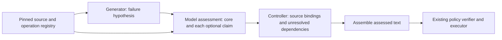

# Source-bound hypotheses before review prose

Recommend a small architectural prototype that changes the generator's handoff
and the controller's decision granularity. The generator should propose a
structured failure hypothesis with HEAD execution, matching BASE operations
and separately identified impact/repair statements. Assess those objects before
assembling the review prose. This is a proposed experiment, not an implemented
or adopted pipeline.

## Why this direction

The latest [input-specificity diagnostic](../../handoff/grafana-claim-specificity-20261004/RESULTS.md)
has four fresh assessments per condition: broad residual establishes the specific
new path 2/4, the verbatim precise finding 4/4, old-race attribution is rejected
4/4. There are two precise-only positive pairs and two both-pass pairs. Prompt,
schema, runtime and source stay fixed. The supplied precise package already
contains a producer's witness; this does not establish autonomous discovery or
isolate precision from its other changed assertions and repair advice.

The precise package's false restart-only persistence survives all four checks.
All qualify unverified test absence and mark the original insufficient_evidence,
yet separately establish the core defect. Treating the original verdict as one
gate would either lose a real narrower finding or leave unsupported prose
attached to it. An explicit core witness helped assessment here; it did not
make every statement reliable.

| Approach | What it changes | Evidence and tradeoff |
|---|---|---|
| Another critic after a prose finding | Adds a model vote to the current handoff | Fast to prototype, but earlier staged and repair-check work carried wrong assessments into comments and sometimes vetoed valid repairs. More calls alone do not fix the demonstrated granularity problem. |
| Source-bound hypothesis and per-claim decisions | Changes what is handed off, what provenance binds, and what the controller may render | Recommended prototype. Tests whether explicit operations and separate obligations preserve the core while removing wrong impact. Extra structure can cause abstentions; semantic correctness still depends on model judgment. |
| Independent BASE and HEAD investigations | Changes source exposure and inference topology | Could reduce historical conflation, but adds inference/reconciliation cost. The current negatives are already 4/4 and supplying a precise path helps more directly. Reserve this for a later isolated comparison if source-bound hypotheses still fail. |

Existing [staged assessment/writer](../../handoff/staged-claim-results.md),
[repair checking](../../handoff/repair-check-results.md),
[bounded investigations](../../handoff/bounded-investigations/README.md) and
[consumer-operation expansion](../../handoff/consumer-operations/README.md)
remain useful components and failure evidence. Do not silently re-enable their
rejected configurations. Whole-function retrieval alone missed the Rito
producer/consumer interaction; source availability is not a correct causal handoff.

## The handoff and controller



These are logical responsibilities, not a commitment to one extra model call
per box or per sentence. Keep the first experiment's total budget fixed; record
source preparation, generation, assessment and rendering costs separately.

The hypothesis needs a small set of linked objects:

- **Core failure:** expected contract, necessary preconditions and concrete
  user-visible effect. The changed-code anchor remains one path/line.
- **HEAD steps:** actor/frame IDs, actual source-operation references, relevant
  observations and explicit ordering. Name which caller receives and writes
  which index; a real Write quote alone does not bind it to Search.
- **BASE correspondence:** map the same conceptual steps and initial state to
  BASE operations. Record the guard that blocks a step, or acknowledge the
  same effect was reachable. Changing to a different old two-miss schedule
  cannot establish the comparison.
- **Optional claims:** each impact qualification, historical assertion, test
  statement and repair alternative has its own ID, dependencies, exact proposed
  text and assessment. Unknown test coverage must not withhold an established
  core. No full rebuild does not establish no incremental recovery.

This is an untrusted artifact, not an authoritative plan or proof. Each model
judgment remains an assessment. Missing links become explicit needs_evidence;
the controller cannot fill them with a confident top-level label.

A compact example of the internal relationships is:

```json
{
  "hypothesis_id": "h1",
  "core": {"claim_id": "c1", "head_steps": ["s1", "s2", "s3"]},
  "base_correspondence": [
    {"head_step": "s2", "base_step": "b2", "blocking_guard": "g1"}
  ],
  "claims": [
    {"id": "c1", "kind": "failure", "depends_on": ["s1", "s2", "s3"]},
    {"id": "c2", "kind": "impact", "depends_on": ["c1", "recovery-check"]}
  ]
}
```

This illustrates IDs and dependencies, not a finalized schema. Actual steps
must carry hash-bound revision/path/range/operation IDs from the source registry;
the model cannot define new source facts by choosing an ID.

## What can be enforced mechanically

Derive operation/declaration IDs from pinned source using the existing retained
parser machinery as a starting point. That helper currently returns function
ranges; named declarations and individual call sites would require a bounded
extension, not an assumption that they already exist. Start with Go and the
provided operations rather than creating a general program-analysis engine.

Check source hash and revision, exact ranges/quotes, enclosing declaration,
existing operation IDs, same-step BASE mappings, complete required claim IDs
and acyclic dependencies. A step assigned to Search cannot cite handleEvent's
Write as an operation executed in that Search frame. Cross-frame calls need
their actual call-site reference; uncertain interface dispatch remains explicit.
Unsupported/malformed parsing supplies no certified operation binding, never
evidence that the operation is absent.

Require the structured change decision to match the recorded BASE comparison:
same-path BASE reachability cannot accompany introduced/newly_exposed.
Unresolved required dependencies cannot accompany promotion of that claim.
Apply these rules to recorded values; they do not prove the values true.

This can reject misplaced citations, omitted obligations and contradictory
records. It cannot prove aliasing, runtime reachability, correct lock reasoning,
exhaustive mitigation coverage or that a model's verdict is true. Those remain
model/source-audit questions. Do not turn syntax membership into a semantic
security guarantee or demand full-program proof to retain a source-established
library defect.

## Presentation and experimental scope

Assemble only claim text explicitly assessed for inclusion; optional unknown or
refuted impact/repair units do not erase an established core. Preserve exact
assessed text, then run the existing whole-artifact policy verifier and independent
executor verification. No final writer should invent a mitigation, duration or
repair while joining approved units. Deterministic assembly controls new text;
it does not rescue a false assessment. Final ten-finding policy and one-anchor
provenance remain the existing review contract.

The minimum prototype is an opt-in component comparison, not a whole-repo planner
or deployment. Reuse drive_session, pinned source assembly, deadline handling,
receipt capture and the verifier. Exercise the new hypothesis tool/record and
controller in the actual experimental runtime; avoid a prompt-only adapter
described as an architecture change. Reuse source-selection machinery separately
and measure its missing-evidence failures rather than hand-rescuing them.

First test the two demonstrated failure classes: preserve a correct new path
while rejecting restart-only impact, and reject a preexisting caller race's
newness. Include the previous wrong-Search-writer and wrong-BASE-replay artifacts
as structural regressions. Then add independently source-audited unused cases
before calling any gain general. No Rito experiment is necessary for the first
component screen; the user's deferral still applies.

Freeze a fresh monolithic control and native hypothesis candidate, same selected
source, model and shared total budget. Preserve real narrower findings, source-correct
history, valid repair strategies and all wording outcomes; report abstention,
completion and cost. Add deterministic tests for wrong owner bindings, mismatched
source revisions, missing required claims, unresolved dependencies and exact
rendered-text inclusion. Do not grade only JSON acceptance or a top-level label.

The twelve-assessment input diagnostic is complete. This architecture prototype
has not been implemented or launched; it is the concrete next experiment proposed
for review, with no production/PR/Rito change.
